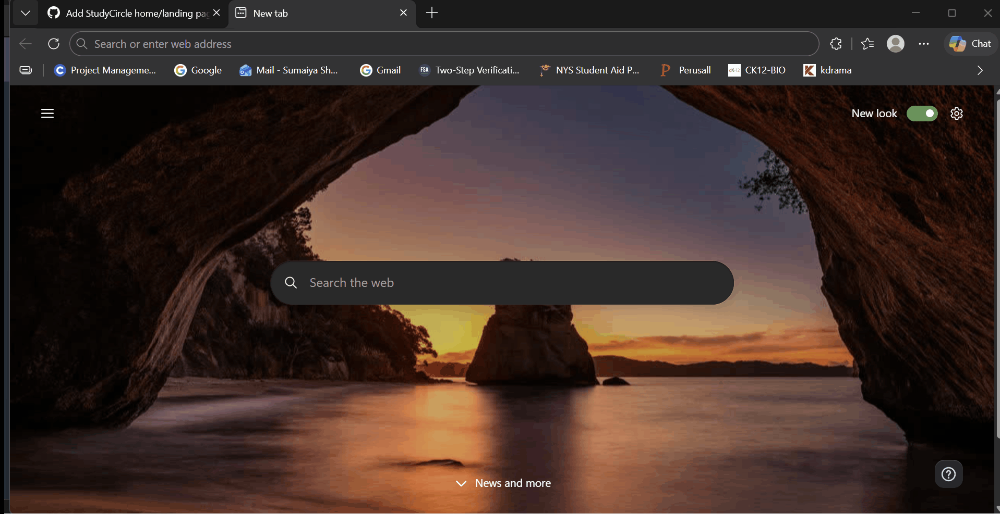
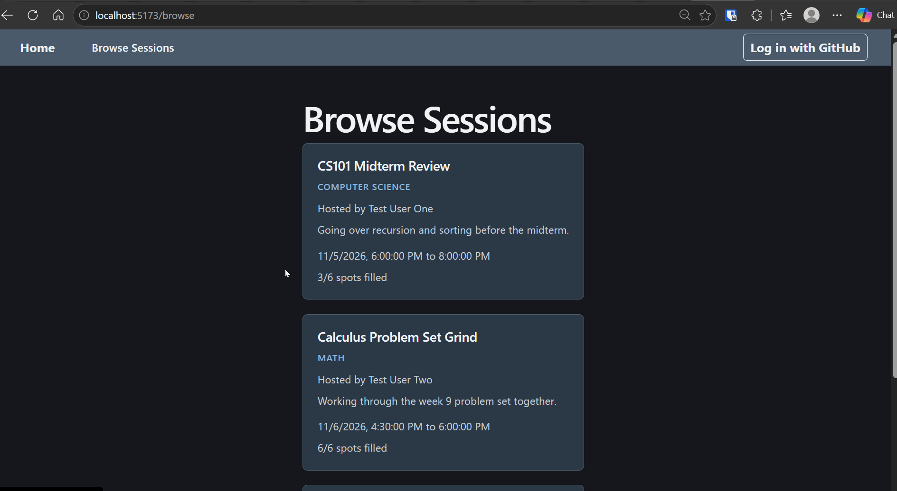
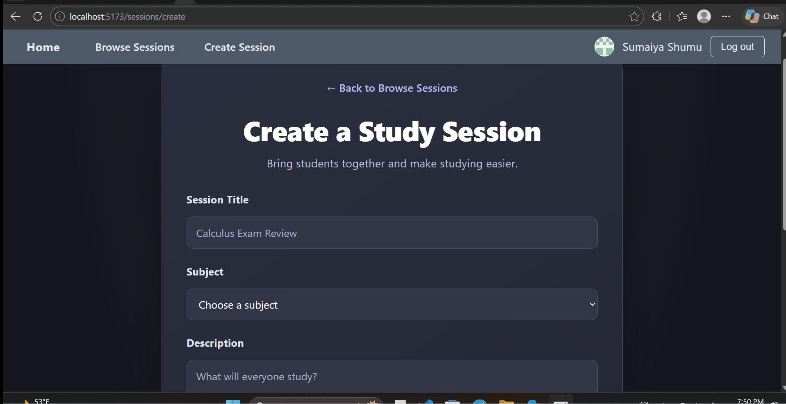

# StudyCircle

CodePath WEB103 Final Project

**Designed and developed by:** Matthew La, Ime Iyonsi, Khadeja Ahmar, Sumaiya Shumu

**Link to deployed app:** Coming soon

## About

### Description and Purpose

StudyCircle is a web application that helps students organize, discover, and join study sessions. It provides a convenient place for students to connect with others who are studying similar subjects.

Our goal is to make group studying more accessible, organized, and collaborative.

### Inspiration

StudyCircle was inspired by students who want to study with others but struggle to find classmates who share their academic interests or schedules.

We wanted to create a platform where students could easily discover existing study sessions or organize their own.

## Tech Stack

**Frontend:** React, JavaScript, CSS, Vite

**Backend:** Node.js, Express.js

**Database:** PostgreSQL

**Authentication:** GitHub OAuth

**Development Tools:** Git, GitHub, VS Code, Render

## Features

### ✅ Home/Landing Page

A responsive homepage that introduces StudyCircle and helps students discover study sessions.

Features include:
- A welcoming hero section.
- Navigation to available study sessions.
- Feature cards explaining the platform.
- A responsive layout and footer.



### ✅ Browse Study Sessions

Students can browse available study sessions and view important information, including the session title, subject, host, description, scheduled time, and attendee capacity.



### ✅ Session Details

Students can open an individual session to view its details, including:
- Session title and subject.
- Host information.
- Session description.
- Start and end times.
- Number of attendees and maximum capacity.
- Current session status.

Authenticated session hosts can also access the Edit Session page.

<!-- Add this GIF after recording it. -->
<!--  -->

### ✅ Create Session

Authenticated users can create new study sessions.

Users can enter:
- Session title.
- Subject.
- Description.
- Start and end times.
- Maximum number of attendees.

The application validates the submitted information, saves the session to PostgreSQL, and redirects the user to the Session Details page.

### ✅ Create Session

Users can create new study sessions.



### ✅ Edit Session

Authenticated users can edit study sessions they created.

The Edit Session page automatically loads the existing session information and allows the host to update:
- Session title.
- Subject.
- Description.
- Start and end times.
- Attendee capacity.

Only the session host is authorized to update the session. Changes are saved to the PostgreSQL database.

<!-- Add this GIF after recording it. -->
<!--  -->

### ✅ Search, Filter, and Sort

Students can search for sessions by title, subject, or description.

Additional options include:
- Filtering sessions by subject.
- Sorting sessions by earliest or latest start time.
- Displaying a message when no sessions match the search.

<!-- Add this GIF after recording it. -->
<!--  -->

### ✅ GitHub Authentication

StudyCircle supports GitHub OAuth authentication.

Users can:
- Log in securely using their GitHub account.
- Access authenticated features.
- Create and manage their own study sessions.
- Log out of their account.

The backend verifies authentication and session ownership before allowing session modifications.

<!-- Add this GIF after recording it, if desired. -->
<!--  -->

## Planned Features

### Delete Session

Allow session hosts to delete sessions that are no longer needed.

**Status:** Planned

### RSVP to Session

Allow students to register their attendance for study sessions.

**Status:** Planned

## Installation Instructions

### Prerequisites

Make sure you have the following installed:

- Node.js and npm.
- Git.
- PostgreSQL database access.
- A GitHub OAuth application for authentication.

### 1. Clone the Repository

```bash
git clone https://github.com/web103-group18/web103_finalproject.git
cd web103_finalproject
```

### 2. Install Backend Dependencies

```bash
cd server
npm install
```

### 3. Configure Environment Variables

Create a `.env` file in the `server` directory and configure the following environment variables:

```env
PORT=3001
DATABASE_URL=your_postgresql_connection_string
GITHUB_CLIENT_ID=your_github_oauth_client_id
GITHUB_CLIENT_SECRET=your_github_oauth_client_secret
SESSION_SECRET=your_secure_session_secret
```

Never commit your `.env` file or credentials to GitHub.

### 4. Start the Backend

From the `server` directory:

```bash
npm start
```

The backend should start at:

http://localhost:3001

### 5. Install Frontend Dependencies

Open a separate terminal:

```bash
cd client
npm install
```

### 6. Start the Frontend

```bash
npm run dev
```

Open the local address displayed by Vite, typically:

http://localhost:5173

### 7. GitHub OAuth Configuration

For local authentication, configure your GitHub OAuth application with:

**Homepage URL:**

http://localhost:5173

**Authorization callback URL:**

http://localhost:3001/auth/github/callback

The application also requires an initialized PostgreSQL database containing the appropriate tables and subjects.

**Warning:** The database reset script drops existing tables. Do not run it against a database containing information you want to preserve.

## Project Progress

### Milestone 3 — Unit 7

Completed the initial project setup, PostgreSQL database structure, homepage, navbar, and browsing interface.

### Milestone 4 — Unit 8

**100% GitHub milestone completion — 6 of 6 issues closed.**

Completed:
- GitHub authentication.
- Sessions API integration.
- Session Details.
- Create Session.
- Session Editing.
- Search, Filter, and Sort.

### Final Milestone — Unit 9

Next priorities include completing additional functionality, testing the application, preparing deployment, and presenting the final project.

## GitHub Repository

https://github.com/web103-group18/web103_finalproject

